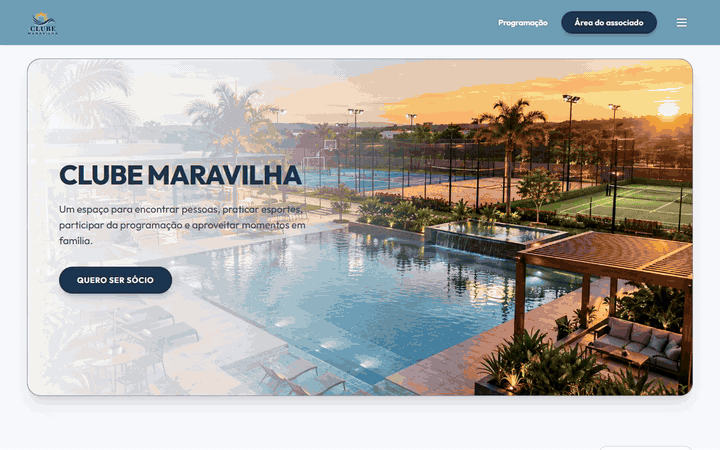
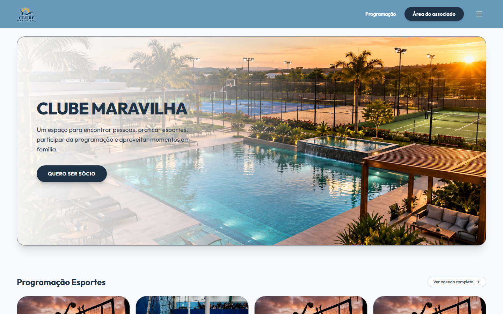
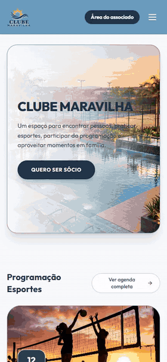

# Clube Maravilha — Sports Club Management System

> Full-stack system for a sports club with ~300 members: membership, monthly billing with dynamic Pix, WhatsApp reminders, court booking, guest passes and facial-recognition turnstile integration.

  

## Highlights

<!-- XYZ: "Accomplished [X] as measured by [Y], by doing [Z]". Troque/adicione números de negócio que o cliente autorizar. -->

- **Unified membership, billing, booking and access control for ~300 members** into one system, by building a FastAPI backend, a React admin panel and a dedicated WhatsApp engine, orchestrated with Docker Compose.
- **Automated monthly collection**, as measured by a 4-step WhatsApp reminder schedule (D-3, D0, D+3, D+7) that never sends twice, by combining batch invoicing, dynamic Pix with webhook confirmation and an idempotent, single-worker scheduler.
- **Prevented double court bookings under concurrency**, as measured by Postgres concurrency tests, by locking the slot with `SELECT ... FOR UPDATE` inside the booking transaction.
- **Delivered the MVP with a strong safety net**, as measured by 1,100+ automated tests and 93% backend coverage, by building every feature test-first in about 6 weeks.

## The story (STAR)

### Situation

Membership, monthly fees, court bookings and guest entries were tracked separately and by hand. Charging ~300 members every month meant manual reminders, late payments were hard to follow, and the front desk had no reliable way to know who was allowed in.

### Task

Deliver an MVP that manages members and families, bills every month and reminds members automatically, lets members book courts and invite guests, and connects to the club's facial-recognition turnstile so access follows payment status.

### Action

- **Monorepo with three services:** a FastAPI backend (API, billing scheduler and send queue), a React admin/public frontend, and a separate Node/TypeScript WhatsApp engine called over HTTP with an API key, isolating WhatsApp's long-lived connection from the API.
- **Layered backend:** endpoints → services → repositories → models, with every admin router mounted under one JWT-protected router, so a new admin route is protected by default.
- **Billing:** monthly invoices generated in batch, dynamic Pix with webhook confirmation, manual payment (Pix, card, cash), automatic overdue marking, and every WhatsApp message logged per invoice and stage so reruns never spam members.
- **Members and guests:** full registration with families and plans, custom due day, a tolerant Excel/CSV importer that reports problems line by line, and 8 free guest passes per month with temporary QR codes (extra guests go on the next invoice).
- **Access control:** court booking blocked for overdue members, and the turnstile denies entry after a one-month grace period.
- **Resilient WhatsApp engine:** exponential reconnection with jitter, handling of WhatsApp's disconnect codes, JID cache with TTL, simulated typing and an 8–20 s anti-ban queue.
- **Safe migrations:** one command handles both an empty database (create + stamp) and an existing one (upgrade).

### Result

- Billing, reminders, bookings and access control now run from one system instead of separate manual processes.
- Members with overdue payments are automatically blocked from booking and, after the grace period, from entry.
- The club got a public website with its sports and events schedule and a members' area.

<!-- Adicione resultados medidos e autorizados pelo cliente, ex.: "inadimplência caiu de A% para B%", "X reservas/mês online". -->

## Tech stack

Python 3.11 · FastAPI · SQLAlchemy 2.0 (async) · Alembic · PostgreSQL 16 · APScheduler · React 18 · TypeScript · Vite · Tailwind CSS · Node.js / Baileys · Docker Compose · Nginx · pytest · Vitest

## Screenshots

| Website (desktop) | Website (mobile) |
| --- | --- |
|  |  |

<!-- Adicione prints do painel admin com dados fictícios: Dashboard, Associados, Mensalidades, WhatsApp -->

## About this repository

The source code is private due to client confidentiality. This page documents the project, my role and the decisions behind it.
Want something similar for your business? [Get in touch](https://schaidenunes.com/).

**My role:** Full-stack developer, solo project, from requirements to deploy
**Duration:** ~6 weeks (September – October 2026)
